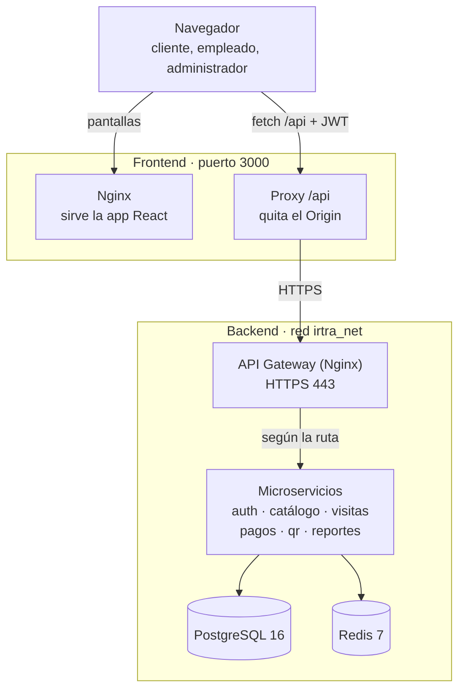

# IRTRA en línea · Frontend

Aplicación web para comprar en línea entradas, parqueo, brazaletes y tickets de juego de los
parques del IRTRA (**Xocomil, Xetulul, Xejuyup y Xetulhá**), entrar al parque mostrando un
código QR y administrar parques, precios y reportes.

Una sola aplicación atiende tres roles: **cliente**, **empleado de taquilla** y
**administrador**. Consume el backend de microservicios del proyecto a través de su API
Gateway en `/api/*`.

> **El frontend no calcula montos.** La cotización, el carnet de afiliado, las categorías de
> edad y los totales vienen siempre del backend; el frontend solo los muestra.

---

## Contenido

1. [Qué hace](#qué-hace)
2. [Arquitectura](#arquitectura)
3. [Tecnologías](#tecnologías)
4. [Cómo ejecutarlo](#cómo-ejecutarlo)
5. [Cuentas y datos de prueba](#cuentas-y-datos-de-prueba)
6. [Pantallas por rol](#pantallas-por-rol)
7. [Decisiones técnicas](#decisiones-técnicas)
8. [Diseño visual](#diseño-visual)
9. [Estructura del proyecto](#estructura-del-proyecto)


---

## Qué hace

**Cliente**
- Registra una visita en 3 pasos (parque y fecha, vehículo, acompañantes con su edad) y ve el
  total actualizado en vivo.
- Paga con tarjeta, depósito, PayPal o transferencia y recibe su código QR.
- Compra brazaletes y tickets de juego del parque de su visita.
- Consulta su historial de pedidos y califica la visita de 1 a 5 estrellas.

**Empleado de taquilla**
- Escanea el QR con la cámara o escribe el código.
- Ve si el código es válido, si el pago está pendiente, si ya se usó, si expiró o si la visita es
  de otro día, y entrega con **Validar y entregar**.
- Revisa sus validaciones del día.

**Administrador**
- Configura parques, productos, precios por edad, venta en línea y promociones.
- Crea cuentas de empleado y activa o desactiva usuarios.
- Consulta reportes de ventas, calificaciones, validaciones, visitantes, productos más vendidos
  y correos fallidos.

---

## Arquitectura



- El navegador solo habla con el contenedor del frontend. Nginx entrega la aplicación y
  reenvía cada llamada a `/api/*` al API Gateway del backend por la red de Docker `irtra_net`.
- Como la app y la API salen del mismo origen (`localhost:3000`), no hay problemas de CORS. El
  proxy además quita el encabezado `Origin`, porque los microservicios solo aceptan
  `http(s)://localhost`.
- El gateway reparte cada petición al microservicio que corresponde según la ruta
  (`/api/auth`, `/api/catalogo`, `/api/visitas`, `/api/pagos`, `/api/qr`, `/api/reportes`).
- El frontend no tiene base de datos propia: todo lo que muestra y cambia viene del backend.

---

## Tecnologías

| Área | Herramienta |
| --- | --- |
| Interfaz | React 18 |
| Construcción y servidor de desarrollo | Vite 6 |
| Navegación y rutas protegidas por rol | React Router 6 |
| Gráficas de reportes | Recharts |
| Lectura de QR con cámara | html5-qrcode |
| Íconos | lucide-react |
| Tipografías (incluidas, sin depender de internet) | Bricolage Grotesque y Figtree |
| Estilos | CSS propio con variables, sin frameworks de componentes |
| Producción | Docker (Node 20 para compilar, Nginx 1.25 para servir) |

---

## Cómo ejecutarlo

### Requisito: el backend levantado

El frontend necesita el backend corriendo con Docker, con las migraciones y los datos de prueba
cargados. Desde la carpeta del backend:

```bash
docker compose up -d --build
docker compose run --rm db-migrate
```

### Opción A · Docker Compose (recomendada)

Compila la aplicación y la sirve con Nginx en **http://localhost:3000**, conectada a la red del
backend.

**1. Configura las variables**

```bash
cp .env.example .env        # en Windows CMD: copy .env.example .env
```

**2. Revisa el nombre de la red del backend**

```bash
docker network ls
```

Busca la que termina en `_irtra_net`. Docker la nombra con la carpeta del backend en
minúsculas, por ejemplo `proyectofinaldesarrolloweb_irtra_net`. Escríbela en `.env`:

```env
BACKEND_NETWORK=proyectofinaldesarrolloweb_irtra_net
```

**3. Levanta el frontend**

```bash
docker compose up -d --build
```

Abre **http://localhost:3000**.

| Variable | Valor por defecto | Para qué sirve |
| --- | --- | --- |
| `PORT` | `3000` | Puerto del equipo donde se publica el frontend |
| `BACKEND_NETWORK` | `proyectoirtrabackend_irtra_net` | Red de Docker del backend a la que se une el contenedor |

Comandos útiles:

```bash
docker compose logs -f frontend    # ver los registros de Nginx
docker compose down                # detener el frontend
docker compose up -d --build       # reconstruir después de cambiar el código
```

> `nginx/frontend.conf` reenvía `/api/*` al contenedor `irtra-api-gateway`, que es el nombre
> que le da el `docker-compose.yml` del backend. Si en tu backend se llama distinto, cámbialo en
> la línea `set $gateway "https://irtra-api-gateway:443";`.

### Opción B · Desarrollo con Vite

Para programar con recarga automática. Requiere **Node.js 20** o superior.

```bash
npm install
npm run dev
```

Abre **http://localhost:5173**. Vite reenvía `/api` al gateway en `https://localhost` (acepta su
certificado autofirmado y quita el `Origin`). Si el gateway está en otra dirección, cambia
`VITE_PROXY_TARGET` en `.env`.

| Script | Qué hace |
| --- | --- |
| `npm run dev` | Servidor de desarrollo en el puerto 5173 |
| `npm run build` | Compila la versión de producción en `dist/` |
| `npm run preview` | Sirve localmente lo que quedó en `dist/` |

---

## Cuentas y datos de prueba

Vienen del seed del backend. La contraseña de todas es **`Password123!`**, y en la pantalla de
login hay un atajo que las rellena.

| Rol | Correo | Entra a |
| --- | --- | --- |
| Cliente con carnet | `afiliado@gmail.com` | `/cliente` |
| Cliente sin carnet | `particular@gmail.com` | `/cliente` |
| Empleado de taquilla | `taquilla@irtra.org.gt` | `/empleado` |
| Administrador | `admin@irtra.org.gt` | `/admin` |

**Tarjetas de prueba:** cualquier número terminado en `0000` se **rechaza**
(`4111 1111 1111 0000`); los demás se aprueban (`4111 1111 1111 4242`).

**Ejemplo para verificar la cotización:** cliente con carnet, Xetulul, fecha de hoy, con
vehículo y acompañantes de 33, 10, 8, 65, 30 y 6 años. Las primeras 5 personas entran gratis
por el carnet; se cobran un adulto (Q140.00), un niño (Q70.00) y el parqueo (Q25.00), para un
total de **Q235.00**.

---

## Pantallas por rol

Al iniciar sesión, la app lee el rol del token y lleva a cada usuario a su zona. Si alguien
abre la ruta de otro rol, por ejemplo un empleado que escribe `/admin`, la app lo regresa a la
suya.

| Rol | Ruta | Pantalla |
| --- | --- | --- |
| Todos | `/login` | Inicio de sesión |
| Todos | `/registro` | Registro de cliente; el carnet es opcional |
| Cliente | `/cliente` | Mis visitas: boletos con parque, fecha, estado del pago y "Ver QR" |
| Cliente | `/cliente/visitas/nueva` | Nueva visita en 3 pasos con resumen en vivo |
| Cliente | `/cliente/visitas/:id/pagar` | Pago del registro; el formulario cambia según el método |
| Cliente | `/cliente/visitas/:id` | Desglose del cobro y código QR ("Disponible al pagar" si falta el pago) |
| Cliente | `/cliente/visitas/:id/calificar` | Calificación de 1 a 5 estrellas y comentario |
| Cliente | `/cliente/pedidos` | Mis pedidos, estilo historial bancario |
| Cliente | `/cliente/pedidos/nuevo` | Brazaletes y tickets del parque; "Pagar" se bloquea con "Primero paga tu entrada" |
| Cliente | `/cliente/pedidos/:id` | Detalle, pago y QR del pedido |
| Empleado | `/empleado` | Escanear con cámara o escribir el código |
| Empleado | `/empleado/qr/:codigo` | Resultado del escaneo y "Validar y entregar" |
| Empleado | `/empleado/validaciones` | Validaciones del día, aceptadas y rechazadas |
| Administrador | `/admin` | Reportes con gráficas y filtros de fecha y parque |
| Administrador | `/admin/parques` | Crear, editar, desactivar y reactivar parques; máximo de personas por carnet |
| Administrador | `/admin/productos` | Crear y eliminar productos (quedan desactivados para no dañar el historial) |
| Administrador | `/admin/precios` | Precio por parque y edad, venta en línea y fechas de promoción |
| Administrador | `/admin/usuarios` | Crear empleados; activar y desactivar cuentas |
| Administrador | `/admin/notificaciones` | Correos que no se pudieron enviar y su error |

**Casos que muestra la taquilla**

| Caso | Aviso | Validar y entregar |
| --- | --- | --- |
| Registro pagado, visita de hoy | Verde: personas, cuántas entran por carnet, cuántas pagaron, parqueo | Activo |
| Pago pendiente | Rojo: "Pago pendiente, no entregar" | Deshabilitado |
| Ya entregado | Rojo: "Este código ya fue utilizado", con fecha, hora y empleado | Deshabilitado |
| Vencido | Rojo: "Código expirado" | Deshabilitado |
| Visita de otro día | Amarillo: "La visita es para otra fecha" | Deshabilitado |
| QR de pedido | Lista de lo que hay que entregar, por ejemplo "3 Brazalete Ilimitado de Juegos" | Activo |

---

## Decisiones técnicas

- **Sesión con OAuth 2.0 y JWT.** El login obtiene un *access token* (15 minutos) y un *refresh
  token* (7 días). Cuando el access token vence, `src/api/client.js` lo renueva solo y repite la
  petición; si varias peticiones vencen a la vez, se hace una sola renovación. Al cerrar sesión
  se revocan los tokens en el backend.
- **Rutas protegidas por rol.** El componente `RutaProtegida` exige sesión y el rol correcto. El
  backend vuelve a validar el rol en cada petición.
- **Un solo cliente HTTP.** Todas las llamadas pasan por `src/api/client.js`, que agrega el
  token, convierte los errores del backend en mensajes legibles (incluidos los de cada campo) y
  convierte a número los IDs que PostgreSQL envía como texto. Las rutas están agrupadas por
  microservicio en `src/api/endpoints.js`.
- **Pagos sin cobros dobles.** Cada intento de pago envía un `Idempotency-Key` único; si el
  usuario hace doble clic o la red reintenta, el backend no cobra dos veces.
- **Validación antes de enviar.** Registro y pago usan las mismas reglas que el backend
  (contraseña segura, tarjeta de 13 a 19 dígitos, vencimiento MM/AA) para avisar al instante.
- **Cotización en vivo.** El resumen de la nueva visita se pide al backend con cada cambio, con
  una pequeña espera para no saturarlo, y siempre se muestra la respuesta más reciente.

---

## Diseño visual

- **Paleta de los parques:** laguna (color principal), maíz (acciones destacadas), selva
  (éxito) y guacamaya (errores), sobre un fondo jade claro.
- **Un color fijo por parque:** Xocomil azul, Xetulul naranja, Xejuyup verde y Xetulhá magenta,
  igual en tarjetas y gráficas, y revisados para que se distingan con daltonismo.
- **Faja típica:** bajo la barra superior hay una franja tejida en zigzag inspirada en las fajas
  guatemaltecas.
- **Boletos perforados:** cada visita se ve como un boleto con el color del parque, línea
  punteada y muescas que separan el talón con el total y el estado del pago.
- **Taquilla legible de lejos:** el resultado del escaneo es un bloque grande verde, rojo o
  amarillo, con ícono y texto.
- **Responsivo y accesible:** funciona desde celular (390 px) hasta escritorio, con barra de
  navegación inferior en móvil, foco visible con teclado y respeto a "reducir movimiento".

---

## Estructura del proyecto

```text
irtra-frontend/
├── docker-compose.yml        Levanta el frontend en el puerto 3000, unido a la red del backend
├── Dockerfile                Compila con Node 20 y sirve con Nginx
├── nginx/frontend.conf       Sirve la SPA y reenvía /api/* al API Gateway
├── .env.example              Variables de Docker Compose y de Vite
├── vite.config.js            Servidor de desarrollo y proxy de /api
├── index.html
├── public/                   Ícono de la app
└── src/
    ├── main.jsx              Punto de entrada: router, sesión, fuentes y estilos
    ├── App.jsx               Rutas de las tres zonas
    ├── api/
    │   ├── client.js         fetch con JWT, renovación de sesión y manejo de errores
    │   └── endpoints.js      Rutas del backend agrupadas por microservicio
    ├── context/
    │   └── AuthContext.jsx   Sesión, rol y redirección
    ├── components/           Marco por rol, boleto, QR, formulario de pago, estrellas, UI base
    ├── pages/
    │   ├── auth/             Login y registro
    │   ├── cliente/          Visitas, pagos, pedidos y calificación
    │   ├── empleado/         Escáner, detalle del QR y validaciones del día
    │   └── admin/            Reportes, parques, productos, precios, usuarios y notificaciones
    ├── styles/global.css     Sistema visual: paleta, tipografía, faja y boletos
    └── utils/                Formato de moneda y fechas, colores por parque
```

---

